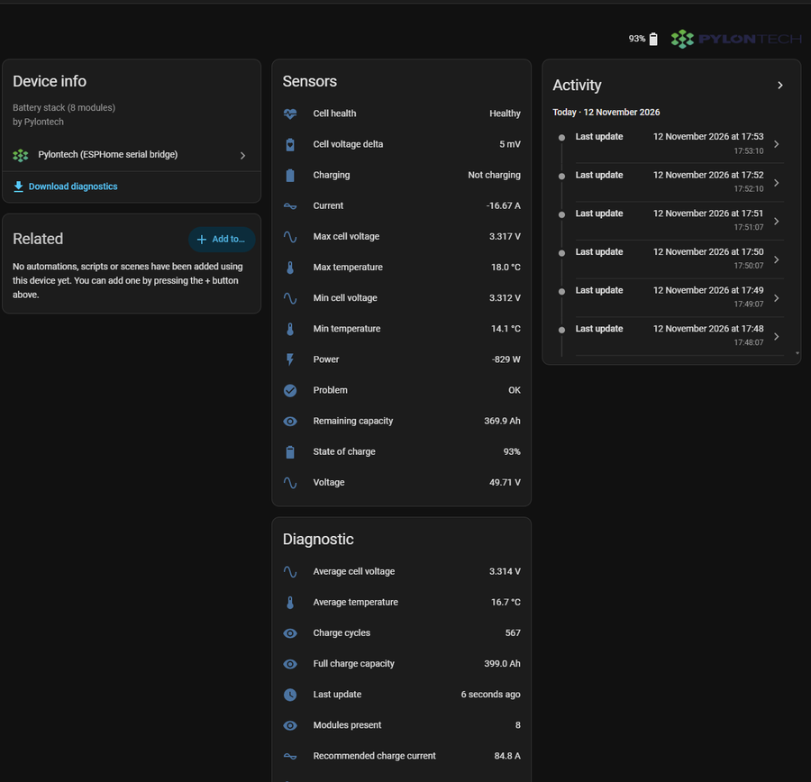
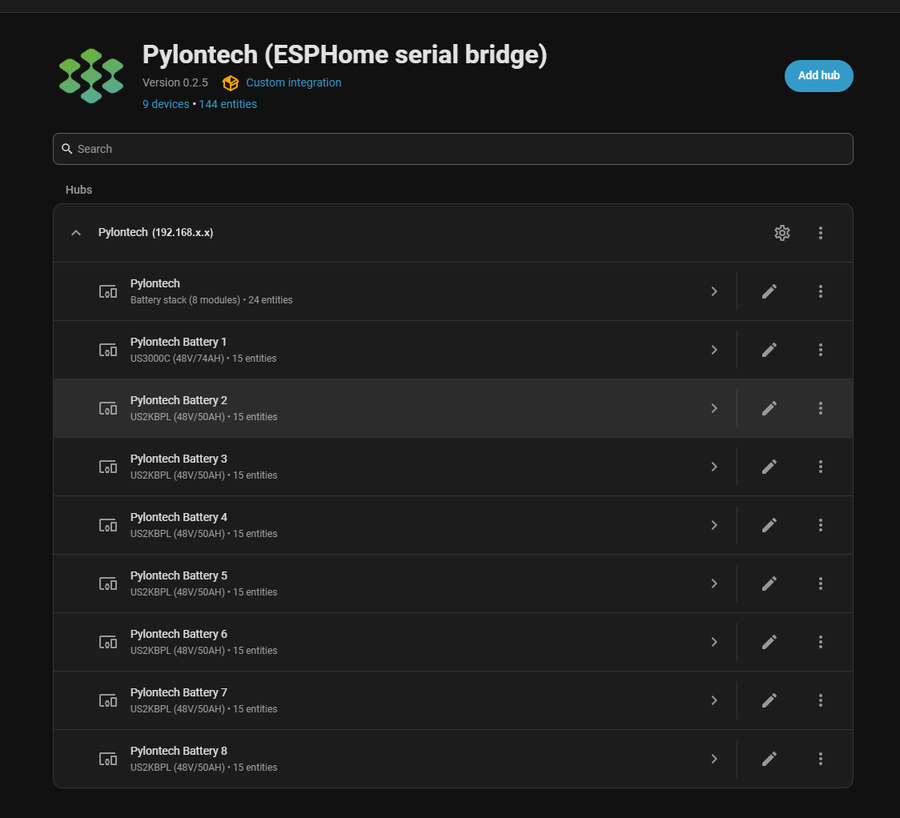
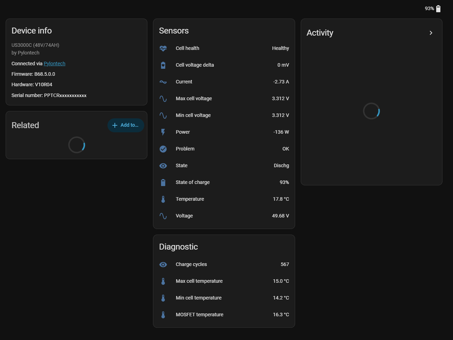
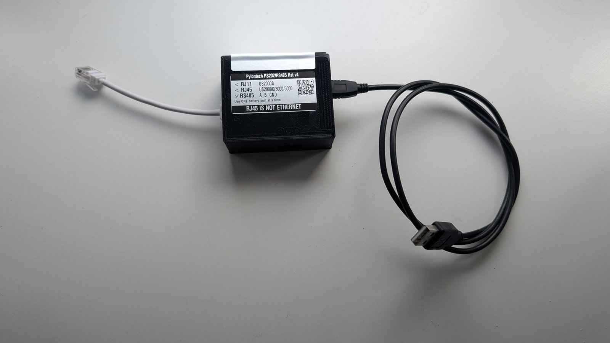
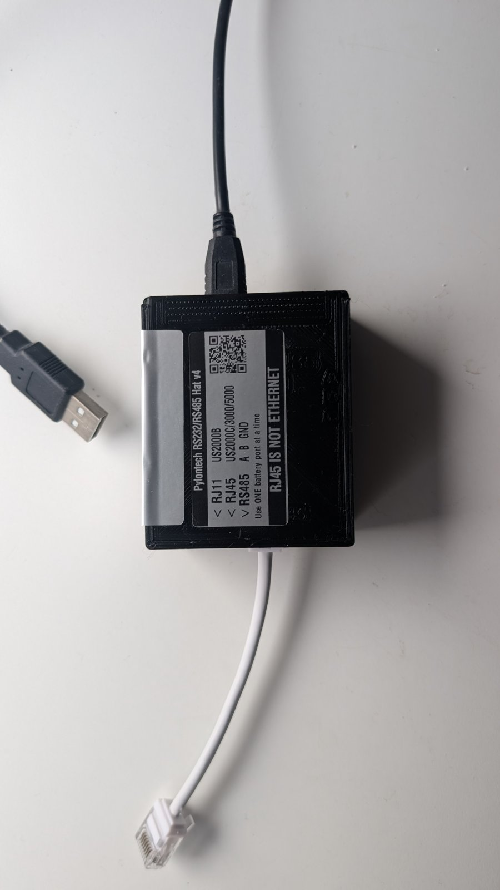

# PylontechToESPHome

Monitor a **Pylontech** battery stack in **Home Assistant** with a cheap
**ESP8266 or ESP32** running **ESPHome**. You get per-module and per-cell data,
a cell-health verdict and the battery's own event log.

Works with any Pylontech that has a **Console** port and speaks the "Type C"
text protocol: US2000B, US2000C, US2KBPL, US3000, US3000C, US3000D, US5000 and
similar. High-voltage towers (Force H, PowerCube) are
[experimental](#high-voltage-stacks-experimental).

**Don't want to build one?** I sell ready-made, pre-flashed units (UK, £20 +
postage). See [Ready-made units for sale](#ready-made-units-for-sale).

**In short:**
1. Connect an ESP to the battery's Console port (through an RS232 adapter).
2. Flash it with the example YAML for your board ([ESP8266](pylontech_example_esp8266.yaml) or [ESP32](pylontech_example_esp32.yaml)).
3. Install this integration in Home Assistant (Marketplace) and point it at the ESP.



---

## How it works

```
Pylontech Console <> RS232  <>  ESP (ESPHome serial_proxy) <> WiFi   <>   Home Assistant
                                plain bridge, no parsing                  "Pylontech" integration:
                                                                          sends commands, parses,
                                                                          creates the entities
```

The battery's Console port answers text commands (`pwrsys`, `pwr`, `bat`,
`info`, `stat`, `data event` …). The ESP just passes the console through to
Home Assistant using ESPHome's `serial_proxy`. The integration in
`custom_components/pylontech/` does all the work. Because the ESP firmware has
no battery logic in it, you don't need to reflash it when the integration is
updated.

(The older approach, where the ESP parsed everything itself, is in
[`legacy/`](#legacy-the-old-way). Use the new way.)

---

## What you need

| | |
|---|---|
| **An ESP** | An **ESP8266** (an ESP-01S is enough) or an **ESP32** (e.g. a D1 Mini ESP32). Or buy a [ready-made unit](#ready-made-units-for-sale). |
| **An RS232 adapter** | The Console port is RS232, not 3.3 V logic, so you need a level shifter such as a MAX3232 / SP3232 module (or the hat). Wire battery TX → ESP RX, battery RX → ESP TX, GND → GND. See [Console pinout](#console-pinout). |
| **ESPHome** | **2026.3.0 or newer** (for `serial_proxy`). The *ESPHome Device Builder* add-on in Home Assistant is fine. |
| **Home Assistant** | **2026.9 or newer**. On 2026.11+ the built-in Marketplace makes installing the integration a click. |

### Console pinout

Plug into the port labelled **Console**, not RS485 or CAN. On a multi-module
stack, use the **master** module's Console port (see
[Troubleshooting](#troubleshooting)). The port runs at **115200 8N1**.

| Battery | Socket | Battery TX (→ ESP RX) | Battery RX (← ESP TX) | GND |
|---|---|---|---|---|
| US2000B / US2000 Plus | RJ11 | pin 3 | pin 2 | pin 1 or 4 |
| US2000C / US3000C / US5000 and newer | RJ45 | pin 3 | pin 6 | pin 8 |

- **RJ45:** a normal straight-through Ethernet patch lead works.
- **RJ11:** the lead must be wired 1-to-1. A normal reversed phone cord swaps
  TX and RX, and you'll get silence.

---

## Part 1 — Flash the ESPHome bridge

*(Bought a ready-made unit? This is already done. Go to Part 2.)*

### Pick the right example YAML

| Your board | Use | Battery UART pins |
|---|---|---|
| ESP8266 (ESP-01S, D1 mini …) | [`pylontech_example_esp8266.yaml`](pylontech_example_esp8266.yaml) | TX **GPIO1**, RX **GPIO3** |
| ESP32 (D1 Mini ESP32 / the hat) | [`pylontech_example_esp32.yaml`](pylontech_example_esp32.yaml) | TX **GPIO18**, RX **GPIO26** |

> **The two files are not interchangeable.** If you put the ESP8266 file on an
> ESP32, every command goes out to the USB chip. Home Assistant then shows
> *"no data parsed"*, and the ESP log shows `>>>` lines with no `<<<` replies.
> If you wired your own ESP32, any free GPIOs will do: just set `tx_pin` /
> `rx_pin` to match.

### Steps

**Get ESPHome, if you don't have it:** in Home Assistant, **Settings →
Add-ons → Add-on Store → ESPHome Device Builder → Install → Start → Open Web UI**.

1. **New device** → name it `pylontech` → pick *ESP8266* or *ESP32*. ESPHome
   creates `pylontech.yaml` with a generated API encryption key. **Keep that
   key line.**
2. **Edit** `pylontech.yaml` and replace everything **except** the
   `api:` → `encryption:` → `key:` lines with the example for your board.
   (The example has `key: !secret pylontech_api_key`. Either put your key in
   `secrets.yaml` under that name, or keep your own `key:` line.)
3. Open **Secrets** (top-right ⋮ menu) and add:

   ```yaml
   wifi_ssid: "YourWiFi"
   wifi_password: "YourWiFiPassword"
   pylontech_ota_password: "SomethingLong"
   ```

4. Set `manual_ip` in the YAML to a **free static IP** on your LAN. Or delete
   the `manual_ip:` block and reserve an address for the ESP in your router.
5. **Install.** The first time, use USB (**Plug into this computer**). After
   that, use **Wirelessly**. A bare ESP-01S needs a USB-serial adapter with
   **GPIO0 held to GND** to flash. That's the fiddly bit, and a good reason to
   use an ESP32 board with USB.
6. **Adopt it in Home Assistant.** When the ESP comes online, HA discovers it
   under **Settings → Devices & services → ESPHome**. Click **Configure** and
   paste the encryption key. This makes the serial port show up in the picker
   in Part 3.

The part that matters (ESP8266 shown; the ESP32 file only differs in the pins
and the logger):

```yaml
uart:
  id: uart_bus
  tx_pin: GPIO1                 # ESP32: GPIO18
  rx_pin: GPIO3                 # ESP32: GPIO26
  baud_rate: 115200
  rx_buffer_size: 4096          # the `pwr` reply is a ~2.6 KB burst; 2048 overruns it

logger:
  baud_rate: 0                  # ESP8266 only: logging must not share GPIO1/GPIO3

serial_proxy:
  - id: pylontech_console
    uart_id: uart_bus
    name: "Pylontech Console"   # must match "Serial port name" in Home Assistant
    port_type: TTL
```

> **ESP8266: keep GPIO1/GPIO3.** Some config tools default `uart:` to other
> pins such as GPIO4/GPIO5. On an ESP8266 those fall back to software serial,
> which can't keep up with 115200 baud once WiFi is running, and the replies
> come back garbled.
>
> `serial_proxy` is an official but still **experimental** ESPHome component.

---

## Part 2 — Install the Home Assistant integration

**Marketplace (recommended, Home Assistant 2026.11+)**

1. **Settings → Marketplace → Add from link**.
2. Enter `https://github.com/guybw/PylontechToESPHome` (the first time, approve
   the GitHub sign-in it asks for).
3. Install **Pylontech (ESPHome bridge)**, then restart Home Assistant.

Installed it through HACS before? The 2026.11 update moves it into the
Marketplace for you.

**Manual**

Copy the `custom_components/pylontech/` folder from this repo into your Home
Assistant `config/custom_components/` folder, then restart.

---

## Part 3 — Add it in Home Assistant

> Needs Home Assistant **2026.9** or newer.

**Settings → Devices & services → Add integration → “Pylontech (ESPHome serial
bridge)”**.

**If you adopted the ESP in the ESPHome integration** (Part 1, step 6), its
serial port is offered in a dropdown — pick
**`<device>: <model> (Pylontech Console)`** and the host, API port and
encryption key are filled in from ESPHome. Nothing else to enter. This is the
same port Home Assistant lists under *Settings → System → Hardware* as
*"connected but not used by any integration"*; setting it up here marks it in
use. (Existing installs pick this up automatically on the first restart after
upgrading — no need to delete and re-add.)

**If you didn't**, or the ESP is offline, choose
**Enter connection details manually...** and fill in:

| Field | Value |
|---|---|
| **Host** | the ESP's IP, e.g. `192.168.1.50` |
| **API encryption key** | the `key:` under `api: → encryption:` in the ESPHome config (same as `pylontech_api_key` in `secrets.yaml`) |
| **Port** | `6053` (default) |
| **Serial port name** | `Pylontech Console` (must match `name:` on the `serial_proxy`) |

That's it — nothing else is configured on the ESP.

**Did it work?** Within a minute you should see a new **Pylontech** device with
~15 sensors (State of charge, Voltage, Power, Cell health …) plus one **Battery
N** sub-device per module. If it says *"Failed to connect"*, check the IP and
that the encryption key matches exactly; if the device appears but everything
is *Unavailable*, the ESP isn't talking to the battery yet — see
[Troubleshooting](#troubleshooting).

---

## What you get

A **Pylontech** stack device, plus **one device per battery module** (each
shows its own model / spec / firmware / serial — mixed stacks are fine).



**Stack**

- State of charge, State of health
- Voltage, Current, Power
- Remaining / Full-charge capacity
- Min / Average / Max cell voltage, **Cell voltage delta (mV)**
- Min / Average / Max temperature
- Charge cycles
- **Energy charged / Energy discharged (kWh)** — add these to the Energy
  dashboard as the battery's "energy going in" and "energy coming out"
- Stored energy (kWh), **Time to full**, **Time to empty**
- **Cell health** — `healthy` / `degrading` / `failed` / `unknown`
- **Balance status**, **Balance score**, **Last full charge** (see
  [Balance tracking](#balance-tracking))
- Last update (disabled by default — it changes on every poll and fills the
  logbook)
- Binary: **Charging**, **Problem**

**Per module**

- Voltage, Current, Power, State of charge, Temperature
- Min / Max cell voltage & temperature, MOSFET temperature
- State (`Charge` / `Dischg` / `Idle` …)
- **Cell health** (with `spread_mv` / `condition` attributes)
- Binary: **Problem**, plus **Voltage alarm**, **Current alarm** and
  **Temperature alarm** (the battery's own state text is in the attributes)



**Cell health** uses the cell-voltage spread, only judged when conditions are
valid (enough load or a clean idle plateau, sensible SoC, not cold) — the
method from [simonpasley/pylontech-battery-health](https://github.com/simonpasley/pylontech-battery-health).

**Energy and time estimates.** The energy counters are added up from the stack
power at every poll, so they start at zero when you install this version and a
shorter poll interval makes them more exact. A gap (restart, lost link) is left
out, not guessed. Time to full / empty divide the battery's own capacity
figures by the present current, and only show a value above 0.5 A.

### Dashboard and battery card

Tick **Create Pylontech dashboard** (off by default) when you add the integration (or later
under **Configure**) and a **Pylontech** dashboard appears in the sidebar: the
battery card, then energy, balance and 24-hour history. It is an ordinary
dashboard, so edit or delete it as you like; ticking the box again rebuilds it.

The **Pylontech Battery** card is also in the card picker, so you can put it on
any dashboard. It needs no configuration: it finds the stack and its batteries
by itself. Click a battery's name for its status and alarms, **Temp** for its
temperatures, **ΔV** for the cell heat map (needs *Per-cell sensors*), and
anything else for its history.

```yaml
type: custom:pylontech-battery-card
# all optional
title: PYLONTECH
device_id: <stack device id>   # only if you have more than one stack
soc_warning: 30
soc_alarm: 15
temp_warning: 40
temp_alarm: 50
delta_v_warning: 30
delta_v_alarm: 50
```

The card is adapted from
[jtubb's Pylontech Battery Card](https://github.com/jtubb/Pylontech-Battery-Card).

### Balance tracking

The BMS only balances cells while the stack sits at full charge. Every time it
does (98 % or more, until it drops below 95 %), the integration records the
cell spread of each module at the start and averaged over the last 15 minutes.
Nothing to start, nothing to configure.

| Balance status | |
|---|---|
| `balanced` | every module within 30 mV at the last full charge |
| `under_watch` | reached full, but the spread had not closed up yet |
| `weak_cell_suspected` | still over 100 mV after two hours or more at full |
| `balance_recommended` | no full charge in the last two weeks (or none seen yet) |

**Balance score** is 100 at or under 30 mV for the worst module, falling in a
straight line to 0 at 200 mV. Attributes on *Balance status* give the per-module
`start_delta_mv` / `end_delta_mv`, the `worst_module`, how long the stack stayed
full and how many full charges there were in the last 30 days.

### High-voltage stacks (experimental)

Force H / PowerCube towers (an SC0500 / SC1000 management unit in front of
H48050-style modules) use the same console with different tables. The
integration spots this from the first `pwr` reply and switches to
`pwr` + `unit` (+ `bat` for per-cell sensors) by itself.

**This has not been run on a real tower yet.** It is built and tested against
console captures from firmware B50 and B52. If you try it, please open an issue
with the diagnostics download either way.

- You get the stack, one device per module, cell health, energy, balance
  tracking and an **Error code** sensor.
- The management unit reports no state of health, cycle count or full-charge
  capacity, so those sensors (and Time to full) are not created.
- Modules are numbered from the bottom of the tower, as the console does.
- With per-cell sensors on, one `bat` reply covers every cell (about 10 KB for
  eight modules). Raise `rx_buffer_size` in the ESPHome YAML to `16384`.

---

## Options

**Settings → Devices & services → Pylontech → Configure**

| Option | Default | Notes |
|---|---|---|
| **Poll interval** | 60 s | `pwr` + `pwrsys` every interval; `stat` every 30 min; `info` once. |
| **Per-cell sensors** | off | Adds a voltage sensor for every cell (15/module), a **Weakest cell** sensor, and a **Balancing** binary sensor per module. One extra `bat N` per module per poll. Turning it back off removes those entities. |
| **Sync battery clock** | off | Sets the battery RTC to Home Assistant's time on every connect (see below). |
| **Create / rebuild Pylontech dashboard** | off | One-off: builds the [dashboard](#dashboard-and-battery-card) when you press Submit. Rebuilding replaces your edits to it. |

---

## Services

**`pylontech.get_log`** — read the battery's on-device log (Developer Tools →
Actions, or `response_variable:` in a script/automation).

| Field | |
|---|---|
| `source` | `event` (faults / state changes) or `history` (periodic samples) |
| `count` | 1–50 recent records |
| `config_entry_id` | only if you have more than one stack |

Each record: index, time, `time_valid`, pack V/I/T/SoC, state flags, decoded
`power_events` / `bat_events` / `system_fault`, an **`alarm`** boolean, and a
per-cell snapshot.

**`pylontech.set_time`** — set the battery RTC (optional `datetime`, defaults to
now). The console's `time` command only accepts a **2-digit year**
(`time <yy> <MM> <dd> <HH> <mm> <ss>`) — the form the OEM *BatteryView* tool
uses. Only affects **future** log timestamps; the RTC otherwise loses time on a
full power-down.

**`pylontech.wake`** — send the 1200-baud wake frame a silent battery needs
after a full power-off, then switch back to 115200. Runs automatically after a
few failed polls; this is the manual trigger.

**`pylontech.start_balance`** / **`pylontech.stop_balance`** — run a force-balance
session. The BMS only balances cells at the top of the charge, so there is no
battery command for this: you set the inverter to charge to 100 % and hold, and
the integration times and scores the hold on the **Force balance** sensor:

| State | |
|---|---|
| `charging` | waiting for the stack to reach 98 % (gives up after 48 h → `timed_out`) |
| `holding` | two-hour hold at full; dropping below 95 % restarts the countdown |
| `balanced` | every module within 30 mV at the end of the hold |
| `good_progress` | spread narrowed by at least a quarter, not yet closed — run it again in a few days |
| `cell_behind` | a module did not close up; attributes name the `module`, `cell`, `cell_from_average_mv` and `serial_number` |

Attributes carry `start_delta_mv` / `end_delta_mv` per module (end = average
over the last 15 minutes of the hold) and `hold_ends`. Use the sensor's state in
an automation to switch your inverter to force-charge while it is `charging` /
`holding` and back afterwards. A running session carries on after a Home
Assistant restart or an options change.

---

## Troubleshooting

**Battery returns no data at all.** After a full power-off some batteries stay
silent on the 115200 console until they get a wake frame at **1200 baud**
(`~20014682C0048520FCC3\r`). The integration handles this itself — it sends the
frame at first setup if the console is silent, and again after a few failed
polls: it drops the console to 1200 baud via `serial_proxy`, sends the frame,
switches back, and re-enters debug mode. You can also trigger it manually with
the **`pylontech.wake`** service. The classic USB-serial-adapter-at-1200-baud
method still works too.

**"No data parsed" / the ESP log shows `>>>` lines but never `<<<`.** The ESP
is sending but hearing nothing back. Check these in order:
- **Wrong example for your board.** On an ESP32 the pins must be the ones you
  wired (GPIO18/GPIO26 on the hat), not GPIO1/GPIO3. See
  [Pick the right example YAML](#pick-the-right-example-yaml).
- **Wrong port.** Use the battery's **Console** socket, not RS485/CAN.
- **Cable.** RJ45 needs a straight-through patch lead. RJ11↔RJ45 adapter
  leads don't carry GND (pin 8). An RJ11 phone cord must be wired 1-to-1, not
  reversed.
- **TX/RX swapped** on DIY wiring.

**Responses look corrupted — random garbled bytes mixed into otherwise normal
text.** ESP8266 only. Two common causes:
- The UART isn't actually on GPIO1/GPIO3. See the callout in
  [Part 1](#part-1--flash-the-esphome-bridge): other pins fall back to
  software serial, which glitches under WiFi load.
- `logger:` is missing `baud_rate: 0`, so it's fighting the battery link for
  the same pins.

**Getting real data back, but only one module and never `pwrsys`.** You're
plugged into a *slave* module's Console port, not the master's — a slave only
answers for itself (`pwrsys` comes back short — just a handful of
`Recommend chg/dsg` lines, no `System Volt`/`SOC`/`Total Num`); the
system-wide `pwrsys` view and the full per-module `pwr` table only come from
the master. Run `info` on each module's Console port in turn: the master
reports `Device address : 1`. Note this **isn't** set by the `ADD` DIP
switches — those set the RS485 baud rate and CAN bus termination resistor, not
the stack address — so don't touch them trying to reorder modules; just try
each unit's console port until `info` says address 1.

**`pwrsys` / `pwr` return nothing.** They need debug mode — the integration
sends `login debug` on every connect automatically. If you're poking the
console by hand, send `login debug` first.

**`serial_proxy` won't compile / won't fit the ESP-01S.** Swap the
`serial_proxy:` block for the third-party raw-TCP bridge
[`oxan/esphome-stream-server`](https://github.com/oxan/esphome-stream-server):

```yaml
external_components:
  - source: github://oxan/esphome-stream-server
stream_server:
  uart_id: uart_bus
  port: 6638
```

…and reach it with `ncat <ip> 6638`. Note the **Home Assistant integration
needs `serial_proxy`** — `stream_server` is only for manual console access.

**Log timestamps are wrong / show `00-00-00`.** The RTC lost power. Use
*Sync battery clock* or `pylontech.set_time` — it fixes new entries only.

**`SysError` / `System Fault 0x200` in the log.** `0x200` is an inter-module
communication fault (link cable between packs). Isolated entries right after a
power-up are the normal Pylontech power-on handshake; frequent ones during
running mean a marginal link cable.

---

## For tinkerers — talk to the console yourself

Any `aioesphomeapi` client can open the `Pylontech Console` serial port directly
(the HA integration must be stopped first — the port allows one client at a
time). Useful commands: `info`, `info N`, `pwrsys`, `pwr`, `bat N`, `stat`,
`data event [i]`, `data history [i]`, `help`, `time`, `logout`. Send
`login debug` first or most commands return nothing.

---

## Ready-made units for sale

**As of 12 November 2026 I have a number of ready-made units for sale (UK).**
Each one is an ESP32 board on an RS232/RS485 hat, pre-flashed with the
[ESP32 example](pylontech_example_esp32.yaml), in a 3D-printed case. It has
an RJ11 socket (US2000B) and an RJ45 socket (US2000C / US3000C / US5000 and
newer) for the battery, plus a spare RS485 screw terminal. With one of these,
skip Part 1 and go straight to [Part 2](#part-2--install-the-home-assistant-integration).

 

Email `guybw` at `hotmail` dot `com`. They are £20 + postage.

---

## Legacy (the old way)

`legacy/` holds the original approach: a single ESPHome YAML that parsed the
console in C++ lambdas and published sensors straight from the ESP — no Home
Assistant integration required.

- `legacy/pytlontech.yaml` — single battery
- `legacy/pylontech-8-battery.yaml` — up to 8 modules (hard-coded)
- `legacy/README.md` — the original project docs

It still works, but it's frozen. The new bridge + integration replaces it with
dynamic module/cell discovery, mixed-stack support, health assessment, the
event log, and clock sync. If you were running the old YAML, move to
[Part 1](#part-1--flash-the-esphome-bridge).

---

## Credits

- [irekzielinski/Pylontech-Battery-Monitoring](https://github.com/irekzielinski/Pylontech-Battery-Monitoring)
  — the original console reverse-engineering this is built on.
- [simonpasley/pylontech-battery-health](https://github.com/simonpasley/pylontech-battery-health)
  — excellent standalone health tool (runs on Windows now); the cell-spread
  verdict here follows its method. If a pack is misbehaving, run it.
- [jtubb/Pylontech-Battery-Card](https://github.com/jtubb/Pylontech-Battery-Card)
  — the bundled battery card is adapted from it (MIT): the ISA-101 layout,
  styling and heat maps are jtubb's.
- [mletenay/home-assistant-pylontech](https://github.com/mletenay/home-assistant-pylontech)
  — the high-voltage console captures in `tests/fixtures/hv/` come from its
  test samples (MIT).

Got it working? Please open an issue and say so.
